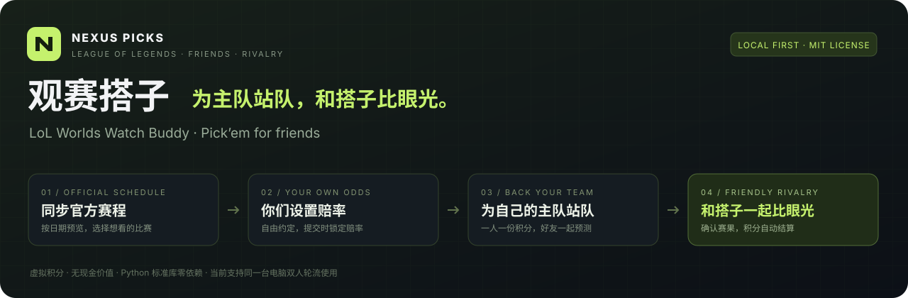

# 观赛搭子｜LOL 世界赛好友积分竞猜 · LoL Worlds Watch Buddy

**NEXUS PICKS · 观赛搭子**让你和朋友在英雄联盟（League of Legends / LOL）世界赛期间一起看比赛，为各自的主队应援，用没有现金价值的积分开展比赛预测和好友比拼。

**LoL Worlds Pick’em for friends:** local-first League of Legends match predictions, official LPL schedule sync, custom odds & leaderboards.

这是一个本地运行的双人赛事预测工具。选择日期，从 [英雄联盟赛事官网 lpl.qq.com](https://lpl.qq.com/) 同步已公布的对阵；你们自行设置双方赔率、投入积分，赛后确认获胜队伍，系统自动结算并更新排行榜。

无需注册，无需安装第三方依赖。房间、预测和积分记录保存在你的电脑中。积分没有现金价值，应用不提供充值、提现、支付或兑换功能。



*原创项目玩法示意，非应用界面截图。*

## 能做什么

- **官方赛程按日同步**：按北京时间 UTC+8 选择日期，预览已公布的全球总决赛、LPL、MSI 等英雄联盟对阵，勾选后导入。
- **赔率完全由你设置**：新导入或手动新建的比赛不会自动填赔率；双方赔率与赛制确认后，才能预测。
- **双人预测与记录**：切换两位玩家，选择支持的队伍和投入积分，每人每场一条有效预测。
- **下注锁定赔率**：调整赔率只影响后续提交；已有预测始终按提交时的赔率结算。
- **封盘与结算**：到开赛时间自动封盘，也可提前手动封盘；赛后手动确认赛果，自动计算返还与净收益。
- **退款与更正**：封盘前可撤回自己的预测；取消比赛返还本金，结算错误可在余额允许时撤销重算。
- **看清两人的战绩**：日期筛选、战队搜索、待设置提醒、排行榜、命中率与积分走势。
- **赛后讨论面板**：每场已确认赛果或已取消比赛都有独立留言区，切换玩家发言、撤回自己的留言，一起复盘关键时刻。
- **本机保存和备份**：SQLite 自动保存，支持导出与恢复 JSON 备份，或开启新赛季重新开始。

## 快速启动

需要 **Python 3.8 或更新版本**和现代浏览器。服务端仅使用 Python 标准库，前端无需构建，不需要 `pip install`、Node.js 或数据库服务。

下载仓库源码并解压，或将仓库克隆到电脑，然后进入包含 `server.py` 的目录。

### macOS

双击 `启动观赛搭子.command`，或在终端运行：

```sh
python3 server.py --open
```

如果脚本没有执行权限，可先运行：

```sh
chmod +x 启动观赛搭子.command
```

### Windows

安装 [Python 3](https://www.python.org/downloads/) 后，双击 `启动-Windows.bat`，也可以在命令提示符或 PowerShell 中运行：

```powershell
python server.py --open
```

### Linux

```sh
python3 server.py --open
```

默认访问地址是 **[http://127.0.0.1:8765](http://127.0.0.1:8765)**。若默认端口被占用，应用会依次尝试 8766–8775；**实际地址以启动窗口显示的地址为准**。`--open` 会尝试打开默认浏览器；也可省略该参数并手动打开地址。

保持启动窗口开启。停止服务时，在启动窗口按 `Ctrl+C`；下次启动后数据仍然保留。

如需指定端口，可以运行：

```sh
python3 server.py --port 8766 --open
```

显式指定 `--port` 时只使用该端口，若已被占用会报错，不会自动更换。

## 从同步到结算

1. **设置你们的房间**：在房间设置中修改两人的昵称和本命战队。默认每人获得 1,000 积分。
2. **选择比赛日期**：点击「同步官方赛程」，按北京时间 UTC+8 选择日期并获取赛程。海外比赛可能在北京时间次日凌晨，请以官方源显示的日期为准。
3. **预览并勾选比赛**：核对队伍、开赛时间、阶段和赛制，勾选想玩的对局后导入。已导入的官方比赛会去重。
4. **亲自设置双方赔率**：在赛程管理或待设置入口中填写 A、B 两方获胜的十进制赔率。有效范围为 1.01–100.00。应用不抓取、推荐或自动生成赔率。
5. **两位玩家分别预测**：顶部切换当前玩家，点击支持队伍的赔率，输入正整数积分，检查预计返还后确认。
6. **赛后确认获胜队伍**：在赛程管理中点击结算，手动选择实际获胜队伍，检查两人的积分预览并确认。同步官方比分不会自动结算你们的积分。
7. **查看战绩并备份**：排行榜会显示总积分、净收益和命中率；在房间设置中导出备份。
8. **赛后一起聊聊**：点击比赛卡片或赛程管理中的「讨论」，或进入「赛后讨论」页面，选择比赛后留言。每条最多 500 字；留言和积分记录一起保存在本机。

没有公布比赛的日期会明确报错，房间不会被添加虚构比赛。若官方只公布时间、对阵仍是 TBD，会提示等待完整对阵；网络故障或官方数据结构变化也会返回错误，不会拿示例或其他日期的赛程顶替。

## 积分规则

系统使用**固定赔率返还**，默认每人 1,000 初始积分。

| 情况 | 积分变化 |
| --- | --- |
| 提交预测 | 立即从可用余额中扣除投入积分，并锁定当时赔率 |
| 猜中 | 返还「投入积分 × 锁定赔率」，包含本金，四舍五入到整数 |
| 猜错 | 返还 0，净收益为负的投入积分 |
| 封盘前撤回 | 全额退回投入积分，不计胜负 |
| 取消比赛 | 本场所有预测全额退款，不计胜负 |

例如投入 **100 积分**、赔率 **1.85**：猜中返还 **185**，净收益 **+85**；猜错返还 **0**，净收益 **−100**。

排行榜按「可用积分 + 待结算本金」比较，已投入但尚未揭晓的预测仍计入总积分。净收益和命中率只统计有效的已结算预测。

**这不是双方互相支付的零和对赌。** 返还积分由本地系统按规则发放；两人可以选择同一支队伍，两人的总积分之和也不必保持不变。

结算可以撤销，但系统需要收回本场已返还的积分。若这些积分已用于其他预测而余额不足，会阻止撤销，避免产生负余额。

## 赛程同步与赔率保护

- 官方赛程来源是 lpl.qq.com 首页实际引用的公开 JSON 数据，说明见 [数据来源](docs/数据来源.md)。具体赛事覆盖以查询时官方源已公布的内容为准。
- 同步排除云顶之弈和暂不支持的赛制，只导入已公布、可识别的对阵；不访问账号，不采集或生成赔率。
- 新比赛的双方赔率保持为空，必须由你们手动设置。
- 重复导入不会复制同一场比赛，也不会覆盖人工赔率。已有预测时，对阵或赛制发生冲突的更新会跳过；已经结算或取消的比赛也会跳过。
- 如需更新已导入比赛的官方时间或比分，在同一天的同步预览中勾选「已导入 · 可更新」的对局，再点击「导入或更新」。已有对局默认不勾选。
- 官方时间变化不会自动重新开放已经封盘的比赛。延期时，请核对新时间，再由你们决定是否开放。
- 手动修改已封盘比赛的开赛时间也会保留封盘状态；确认延期后的时间后，在赛程管理中点击「开放」才会重新接受预测。
- 官方比分只供核对；最终赛果和积分结算由你们手动确认。

开发时在 **2026-10-21** 核验官方源，使用了「2026-10-21 无比赛」「2026-10-24 有 8 场完整对阵」「2026-10-25 对阵仍待定」三种情况检查同步行为。这是当时的数据记录和测试样本，**不是这些日期赛程永远保持不变的承诺**；实际结果以查询时官方源为准。

## 数据和使用范围

- 讨论区按比赛分开显示作者、时间及发言时的赛果。撤销赛果后保留留言并暂停新增发言，重新确认赛果后可继续；讨论不会改动积分。
- 留言草稿按当前比赛与玩家分别保留在当前页面内，自动刷新不会覆盖草稿；刷新整个网页或关闭页面后未提交的草稿不保留。每场最多 200 条、每个房间共 2,000 条留言。
- 首次启动后自动生成 `data/nexus.sqlite3`，保存房间、比赛、预测和积分账本。公开仓库不应包含你的数据库、备份或个人房间数据。
- 在房间设置中导出 JSON 备份；导入会替换当前房间，请先备份现有记录。恢复前会校验数据结构和积分账目。
- 留言包含在备份中。1.2.0 会自动兼容旧数据库和不含留言的旧备份，无需手动迁移。
- 可以开启新赛季，保留玩家信息并重置比赛和积分；清空前需要输入 `RESET`。
- 页面和积分功能可以离线运行；**同步官方赛程需要网络**。官方源故障不影响已保存在本机的对局和积分。
- 当前服务只监听 `127.0.0.1`。支持**同一台电脑轮流切换两位玩家**，或同机浏览器标签页共享账本；不提供远程多人房间、独立登录或账户权限隔离。
- 两位玩家都是可信的房间管理者，都能切换身份、设置赔率和确认赛果。请先约定规则，再开始预测。

如果计划扩展为远程多人服务，需要另外设计身份认证、权限和部署方案。

## 开发与贡献

运行离线测试：

```sh
python3 -m unittest discover -s tests -v
```

测试使用保存的公开赛程样本和临时数据，不需要连接官方赛程服务。实际同步仍受官方数据和网络状态影响。

另有可选的离线前端测试，使用开发电脑已有的 Node.js 或 macOS JavaScriptCore，不需要浏览器、联网或安装 npm 包：

```sh
python3 scripts/test_frontend.py
```

这些测试检查交互逻辑和生成的 HTML，不替代真实浏览器的视觉与操作验收。Node.js 只用于可选的开发测试，运行应用本身仍只需要 Python。

打包干净的源码发布版：

```sh
python3 scripts/package.py
```

ZIP 输出到 `dist/`，打包脚本会排除数据库、私人房间记录和临时研究资料。

项目结构：

```text
server.py              本地 HTTP 服务、SQLite 账本与积分规则
lpl_schedule.py        官方赛程读取、日期校验与数据整理
public/                网页、样式、交互和项目图标
tests/                 积分与赛程同步测试及公开样本
docs/                  数据来源、项目介绍图与发布信息
data/                  首次运行后生成的本机数据，不纳入版本控制
```

欢迎提交问题、改进建议和 Pull Request，详见 [贡献指南](CONTRIBUTING.md)。使用操作见 [使用说明](使用说明.md)，版本变化见 [CHANGELOG](CHANGELOG.md)。

## English overview

**LoL Worlds Watch Buddy** is a local-first, open-source **League of Legends Pick’em** app for friends. Support your favorite team during the **LoL World Championship**, make virtual-point match predictions, and enjoy a friendly rivalry with your watch buddy.

Import confirmed matches from the official LPL schedule by date, choose the matches you want to follow, and set your own decimal odds. Each prediction locks its odds when submitted. Confirm the winner after the match to settle points and compare your friendly leaderboard. There are no payments, deposits, withdrawals, or cash-value rewards.

The current version runs on one computer with two trusted player profiles. It uses Python 3.8+ and the standard library only. Run `python3 server.py --open`, keep the launch window running, and open the local address it prints. Chinese usage instructions and setup details are provided above.

## 名称、素材与许可

「NEXUS PICKS · 观赛搭子」及 N 字图标是为本项目临时原创设计的名称和图形，没有取用现成预测网站的品牌或 Logo。

本项目与 Riot Games、腾讯或 LPL 官方无隶属、赞助或合作关系。英雄联盟、赛事、队伍名称及官方数据属于各自权利方；本仓库的开源许可不代表授予这些第三方内容的商标或其他权利。

代码按 [MIT License](LICENSE) 发布。仅用于无现金价值虚拟积分的朋友娱乐和学习交流。
